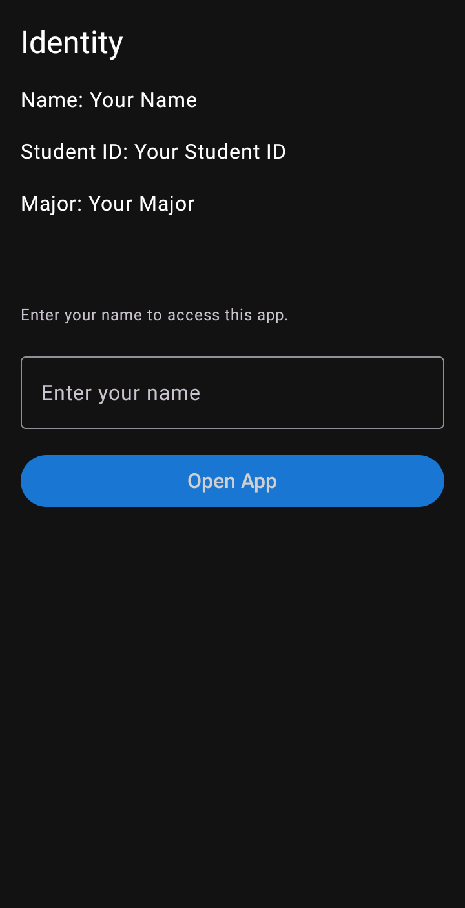
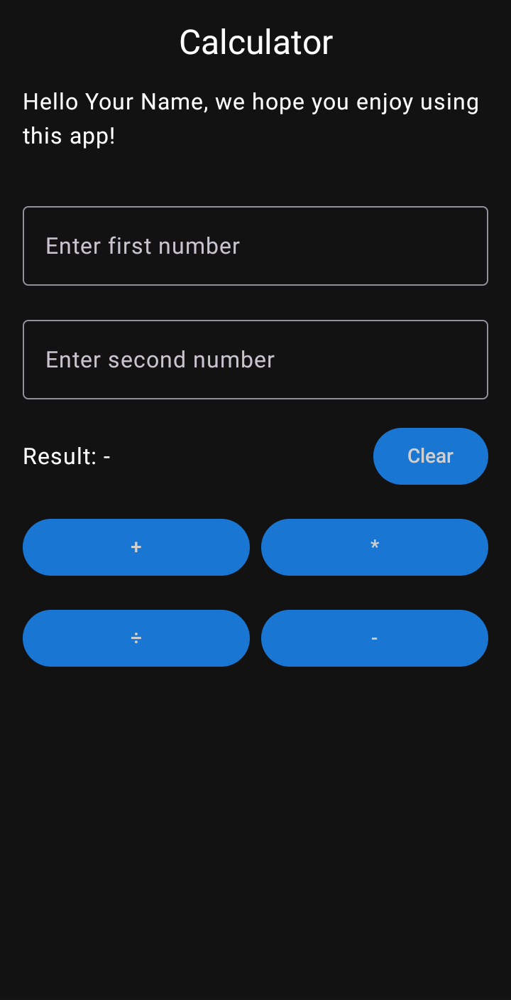

# Android Calculator

A simple Android calculator application built with **Kotlin** and **Jetpack Compose**. This project uses two `Activity` classes:

1. `MainActivity` displays the app creator's identity and a name input form.
2. `CalculatorActivity` displays the calculator after the name is passed through an `Intent`.

## Screenshots

### Main Screen



### Calculator Screen



## Features

- Jetpack Compose-based UI
- Two activities
- Displays the creator's name, student ID, and major
- Passes the user's name from the first activity to the second activity
- Addition, subtraction, multiplication, and division
- Clear button for resetting the inputs and result
- Light and dark theme support

## Technologies

- Kotlin
- Android Gradle Plugin
- Jetpack Compose
- Material 3
- Gradle Wrapper
- Android SDK

Main configuration:

- `applicationId`: `com.example.myapplication`
- `minSdk`: `24`
- `targetSdk`: `37`
- `compileSdk`: `37`
- Java compatibility: `11`

## Requirements

Make sure the following tools are installed:

- JDK 11 or a version compatible with the project configuration
- Android SDK
- Android SDK Platform 37
- Android SDK Build-Tools 36
- Android Platform-Tools (`adb`)
- An Android device or emulator

Check the ADB connection:

```bash
adb devices
```

For a physical device, enable **Developer options** and **USB debugging**, then press **Allow** when the authorization dialog appears.

## Android SDK Configuration

Gradle uses the SDK location specified in `local.properties`. Example:

```properties
sdk.dir=/usr/lib/android-sdk
```

Update this value to match the SDK location on your computer. The `local.properties` file is machine-specific and should not be committed.

If you use the command-line tools, make sure `sdkmanager` and `adb` point to the same SDK specified in `local.properties`.

Example Linux environment variables:

```bash
export ANDROID_HOME=/usr/lib/android-sdk
export ANDROID_SDK_ROOT=/usr/lib/android-sdk
export PATH="$PATH:$ANDROID_HOME/platform-tools"
```

If the SDK licenses have not been accepted:

```bash
yes | sdkmanager --sdk_root="$ANDROID_HOME" --licenses
```

## Running from VS Code

Clone the project and enter the project directory:

```bash
cd MyApplication
```

Make sure the Gradle Wrapper and refresh script are executable:

```bash
chmod +x gradlew
chmod +x refresh.sh
```

Build the debug APK:

```bash
./gradlew assembleDebug
```

The APK will be available at:

```text
app/build/outputs/apk/debug/app-debug.apk
```

Install the application on a connected device:

```bash
./gradlew installDebug
```

Alternatively, use the script to build, install, and launch the application automatically:

```bash
./refresh.sh
```

The script runs:

```text
./gradlew installDebug
adb shell am force-stop com.example.myapplication
adb shell am start -n com.example.myapplication/.MainActivity
```

After making code changes, run the script again:

```bash
./refresh.sh
```

To mirror the device screen on your computer, install and run `scrcpy`:

```bash
sudo apt update
sudo apt install scrcpy
scrcpy
```

## Application Flow

```text
MainActivity
  -> displays the creator's identity
  -> the user enters their name
  -> the user presses Open App
  -> the name is passed through an Intent
  -> CalculatorActivity opens
  -> the user performs calculator operations
```

## Updating the Creator Information

Edit the following values in [`strings.xml`](app/src/main/res/values/strings.xml):

```xml
<string name="full_name">Name: Your Name</string>
<string name="full_nim">Student ID: Your Student ID</string>
<string name="full_major">Major: Your Major</string>
```

After updating the values, run:

```bash
./refresh.sh
```

## Important Project Structure

```text
app/src/main/
├── AndroidManifest.xml
├── java/com/example/myapplication/
│   ├── MainActivity.kt
│   ├── CalculatorActivity.kt
│   └── ui/theme/
│       ├── Color.kt
│       ├── Theme.kt
│       └── Type.kt
└── res/
    ├── drawable/
    ├── mipmap-*/
    └── values/
        ├── colors.xml
        ├── strings.xml
        └── themes.xml
```

`MainActivity` is the launcher activity. `CalculatorActivity` is registered as the second activity in `AndroidManifest.xml`.

## Basic Testing Checklist

Before submitting the project, verify that:

1. The main screen displays the correct creator information.
2. Empty name input displays a validation message.
3. The **Open App** button opens the calculator.
4. The greeting displays the user's name.
5. All operations produce the correct result.
6. Division by zero displays `Error`.
7. The **Clear** button resets the inputs and result.

Run a build verification:

```bash
./gradlew assembleDebug
```

## License

This project was created for educational purposes.
